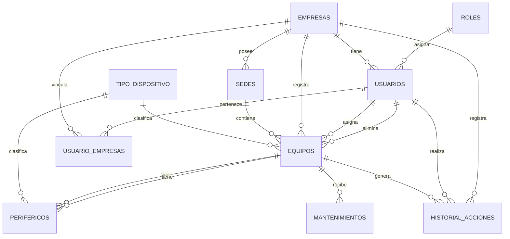

# Modelo de Datos — Sistema de Gestión de Equipos

## Diagrama ER

---

## Tablas

### `empresas`
Empresas registradas en el sistema.

| Columna    | Tipo      | Restricciones | Descripción                        |
|------------|-----------|---------------|------------------------------------|
| id         | INTEGER   | PK, AUTO      | Identificador                      |
| nombre     | VARCHAR   | NOT NULL      | Nombre de la empresa               |
| logo       | TEXT      |               | URL o ruta del logo                |
| created_at | TIMESTAMP | DEFAULT NOW() | Fecha de registro                  |

---

### `roles`
Catálogo de roles del sistema.

| Columna     | Tipo      | Restricciones     | Descripción                                                |
|-------------|-----------|-------------------|------------------------------------------------------------|
| id          | INTEGER   | PK, AUTO          | Identificador                                              |
| nombre      | VARCHAR   | NOT NULL, UNIQUE  | `super_admin`, `gestion`, `visualizador`                  |
| descripcion | TEXT      |                   | Descripción del rol y sus permisos                         |
| created_at  | TIMESTAMP | DEFAULT NOW()     | Fecha de creación                                          |

**Valores fijos:**
- `super_admin` — acceso total a todas las empresas
- `gestion` — puede crear/editar/eliminar equipos en sus empresas
- `visualizador` — solo lectura

---

### `usuarios`
Cuentas de usuario del sistema.

| Columna                | Tipo        | Restricciones       | Descripción                                    |
|------------------------|-------------|---------------------|------------------------------------------------|
| id                     | INTEGER     | PK, AUTO            | Identificador                                  |
| nombre                 | VARCHAR     | NOT NULL            | Nombre completo                                |
| email                  | VARCHAR     | NOT NULL, UNIQUE    | Correo electrónico                             |
| password_hash          | VARCHAR     |                     | Hash bcrypt de la contraseña                   |
| rol_id                 | INTEGER     | FK → roles.id       | Rol asignado                                   |
| empresa_id             | INTEGER     | FK → empresas.id    | Empresa principal del usuario                  |
| estado                 | VARCHAR     |                     | `activo`, `pendiente`, `inactivo`              |
| created_at             | TIMESTAMP   | DEFAULT NOW()       | Fecha de registro                              |
| reset_token            | VARCHAR     |                     | Token para recuperación de contraseña          |
| reset_token_expires_at | TIMESTAMP   |                     | Expiración del token de recuperación           |
| invitation_token       | VARCHAR     |                     | Token para activar cuenta vía email            |
| invitation_expires_at  | TIMESTAMP   |                     | Expiración del token de invitación             |

**Notas:**
- `estado = 'pendiente'`: usuario invitado, aún no activó su cuenta.
- `estado = 'inactivo'`: soft-delete.
- `empresa_id` es la empresa "principal"; el acceso multi-empresa se gestiona por `usuario_empresas`.

---

### `usuario_empresas`
Tabla pivote: qué empresas tiene asignadas cada usuario.

| Columna    | Tipo      | Restricciones       | Descripción             |
|------------|-----------|---------------------|-------------------------|
| id         | INTEGER   | PK, AUTO            | Identificador           |
| usuario_id | INTEGER   | FK → usuarios.id    | Usuario                 |
| empresa_id | INTEGER   | FK → empresas.id    | Empresa asignada        |
| created_at | TIMESTAMP | DEFAULT NOW()       | Fecha de asignación     |

**Notas:**
- `super_admin` no tiene filas aquí; tiene acceso global.
- Un usuario puede estar vinculado a 0..N empresas.

---

### `sedes`
Sucursales o ubicaciones físicas de cada empresa.

| Columna    | Tipo      | Restricciones       | Descripción                            |
|------------|-----------|---------------------|----------------------------------------|
| id         | INTEGER   | PK, AUTO            | Identificador                          |
| empresa_id | INTEGER   | FK → empresas.id    | Empresa a la que pertenece             |
| nombre     | VARCHAR   | NOT NULL            | Nombre de la sede (ej: "Bogotá Centro")|
| ubicacion  | VARCHAR   |                     | Dirección o descripción de ubicación   |
| created_at | TIMESTAMP | DEFAULT NOW()       | Fecha de creación                      |

---

### `equipos`
Inventario de equipos tecnológicos.

| Columna            | Tipo      | Restricciones         | Descripción                                        |
|--------------------|-----------|-----------------------|----------------------------------------------------|
| id                 | INTEGER   | PK, AUTO              | Identificador                                      |
| empresa_id         | INTEGER   | FK → empresas.id      | Empresa propietaria                                |
| sede_id            | INTEGER   | FK → sedes.id         | Sede donde se encuentra el equipo                  |
| asignado_usuario_id| INTEGER   | FK → usuarios.id      | Usuario al que está asignado el equipo             |
| codigo             | VARCHAR   | NOT NULL              | Código único (ej: `EQ-0001`)                       |
| nombre_equipo      | VARCHAR   | NOT NULL              | Nombre descriptivo                                 |
| tipo               | VARCHAR   |                       | `Desktop`, `Laptop`, `Server`                      |
| marca              | VARCHAR   |                       | Marca del fabricante                               |
| modelo             | VARCHAR   |                       | Modelo específico                                  |
| serial             | VARCHAR   |                       | Número de serie                                    |
| estado             | VARCHAR   |                       | `Disponible`, `Asignado`, `Préstamo`, `Mantenimiento`, `Dañado`, `Baja` |
| ubicacion          | VARCHAR   |                       | Área física dentro de la sede                      |
| fecha_asignacion   | DATE      |                       | Fecha en que se asignó al usuario actual           |
| eliminado          | BOOLEAN   | DEFAULT FALSE         | Soft delete                                        |
| eliminado_en       | TIMESTAMP |                       | Cuándo fue eliminado                               |
| eliminado_por      | INTEGER   | FK → usuarios.id      | Quién lo eliminó                                   |
| created_at         | TIMESTAMP | DEFAULT NOW()         | Fecha de creación del registro                     |

**Cambios respecto al modelo anterior:**
- Se eliminan los campos técnicos (`procesador`, `ram`, `disco_duro`, `sistema_operativo`) → migrar a `perifericos`.
- Se elimina `garantia` y `especificaciones` → el mantenimiento y periféricos tienen sus propias tablas.
- Se añade `sede_id` para ubicar geográficamente el equipo.
- `asignado_usuario_id` reemplaza al texto libre `asignado_a`.

---

### `tipo_periferico`
Catálogo de tipos de periféricos o componentes.

| Columna     | Tipo      | Restricciones | Descripción                              |
|-------------|-----------|---------------|------------------------------------------|
| id          | INTEGER   | PK, AUTO      | Identificador                            |
| nombre      | VARCHAR   | NOT NULL      | Nombre del tipo (ej: `Mouse`, `Monitor`) |
| descripcion | TEXT      |               | Descripción del tipo de periférico       |
| created_at  | TIMESTAMP | DEFAULT NOW() | Fecha de creación                        |

**Valores sugeridos:** Mouse, Teclado, Monitor, Audífonos, Cámara web, Impresora, UPS, Otro.

---

### `perifericos`
Dispositivos adicionales o componentes asociados a un equipo.

| Columna     | Tipo    | Restricciones           | Descripción                              |
|-------------|---------|-------------------------|------------------------------------------|
| id          | INTEGER | PK, AUTO                | Identificador                            |
| equipo_id   | INTEGER | FK → equipos.id, NOT NULL | Equipo al que pertenece                |
| tipo_id     | INTEGER | FK → tipo_periferico.id | Tipo de periférico                       |
| marca       | VARCHAR |                         | Marca                                    |
| modelo      | VARCHAR |                         | Modelo                                   |
| serial      | VARCHAR |                         | Número de serie                          |
| descripcion | TEXT    |                         | Descripción o notas adicionales          |

**Nota:** Reemplaza el campo `especificaciones` (JSON) del modelo anterior con una tabla relacional.

---

### `mantenimientos`
Registro de mantenimientos realizados a equipos.

| Columna              | Tipo      | Restricciones           | Descripción                              |
|----------------------|-----------|-------------------------|------------------------------------------|
| id                   | INTEGER   | PK, AUTO                | Identificador                            |
| equipo_id            | INTEGER   | FK → equipos.id, NOT NULL | Equipo que recibió el mantenimiento    |
| fecha_mantenimiento  | DATE      | NOT NULL                | Fecha en que se realizó                  |
| tipo                 | VARCHAR   |                         | `Preventivo`, `Correctivo`, `Garantía`   |
| descripcion          | TEXT      |                         | Descripción del trabajo realizado        |
| tecnico              | VARCHAR   |                         | Nombre del técnico responsable           |
| costo                | NUMERIC   |                         | Costo del mantenimiento                  |
| created_at           | TIMESTAMP | DEFAULT NOW()           | Fecha de registro en el sistema          |

---

### `historial_acciones`
Auditoría de todas las acciones realizadas sobre equipos.

| Columna        | Tipo      | Restricciones       | Descripción                                          |
|----------------|-----------|---------------------|------------------------------------------------------|
| id             | INTEGER   | PK, AUTO            | Identificador                                        |
| usuario_id     | INTEGER   | FK → usuarios.id    | Usuario que realizó la acción                        |
| equipo_id      | INTEGER   | FK → equipos.id     | Equipo involucrado                                   |
| empresa_id     | INTEGER   | FK → empresas.id    | Empresa del equipo                                   |
| accion         | VARCHAR   | NOT NULL            | `CREAR`, `EDITAR`, `ELIMINAR`, `RESTAURAR`, `ELIMINAR_PERMANENTE` |
| equipo_codigo  | VARCHAR   |                     | Código del equipo (desnormalizado para historial)    |
| equipo_nombre  | VARCHAR   |                     | Nombre del equipo (desnormalizado)                   |
| usuario_nombre | VARCHAR   |                     | Nombre del usuario (desnormalizado)                  |
| usuario_email  | VARCHAR   |                     | Email del usuario (desnormalizado)                   |
| usuario_rol    | VARCHAR   |                     | Rol al momento de la acción                          |
| detalles       | TEXT      |                     | Descripción adicional                                |
| ip_address     | VARCHAR   |                     | IP del cliente                                       |
| fecha          | TIMESTAMP | DEFAULT NOW()       | Cuándo ocurrió la acción                             |

---

## Reglas de negocio clave

1. **Un equipo pertenece a una empresa y opcionalmente a una sede** de esa empresa.
2. **Un equipo puede tener múltiples periféricos** (tabla `perifericos`), reemplazando el JSON libre anterior.
3. **Los mantenimientos se registran** con fecha, tipo, técnico y costo, para tener trazabilidad.
4. **El borrado es siempre soft-delete** (`eliminado = TRUE`); borrado permanente solo desde la Papelera.
5. **El historial se registra automáticamente** en cada operación CRUD sobre equipos.
6. **`asignado_usuario_id`** reemplaza el texto libre `asignado_a`; permite saber exactamente qué usuario tiene el equipo.
7. **Un usuario puede tener múltiples empresas** vía `usuario_empresas`; su empresa principal está en `usuarios.empresa_id`.
